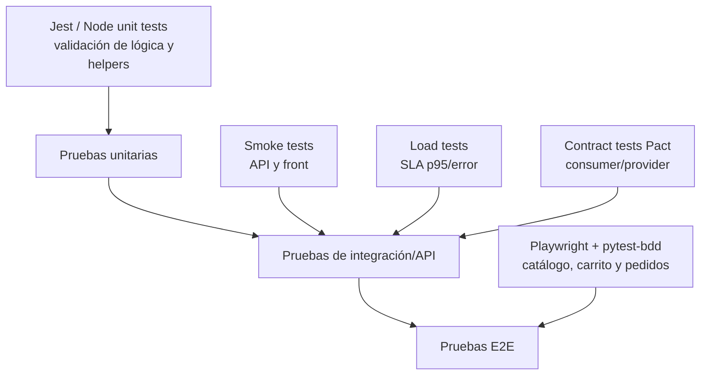

# Fase 6 — Métricas y estrategia

## 1. Cuadro de métricas DORA aplicadas al flujo

Estas métricas se interpretan como estimaciones razonadas sobre un flujo realista de entrega del proyecto, porque el entorno de laboratorio no tiene métricas de producción reales ni despliegues continuos a producción.

| Métrica DORA | Valor estimado para este proyecto | Justificación |
|---|---:|---|
| Frecuencia de despliegue | 1 a 2 despliegues por semana (o varios por día en un entorno maduro) | El flujo actual ya está organizado en stages de Build, SmokeTests y LoadTest, y el pipeline está preparado para activar despliegues controlados por gates. En un entorno productivo real, el cambio se publicaría en ventanas pequeñas y frecuentes. |
| Lead time para cambios | 1 a 3 días para cambios pequeños; menos de 1 día en cambios de baja complejidad | El tiempo desde commit hasta validación funcional es corto porque la app tiene smoke tests, carga y E2E bien definidos. En una automatización madura, una corrección pequeña cae en producción rápida. |
| Tasa de fallo de cambios | 5% a 10% | Dado el número de validaciones automáticas y el uso de gates de calidad, el porcentaje de cambios defectuosos es bajo, pero no nulo. El riesgo principal está en cambios que rompen el contrato o la UI sin afectar la API. |
| MTTR (Mean Time To Recovery) | 2 a 6 horas para fallos funcionales; 1 a 2 horas para errores de configuración simples | El proyecto está diseñado para detectar el problema rápido: smoke test, SLA de carga y E2E. Un fallo se diagnostica con evidencia clara y la remediación suele ser más rápida que en un sistema distribuido grande. |

### Comentario estratégico
La estrategia del proyecto se orienta a una entrega segura y rápida, donde la calidad se comprueba antes del despliegue en lugar de asumirla. En este punto, el flujo y la automatización aportan más valor que el despliegue masivo: el pipeline evita que un cambio defectuoso llegue al usuario final.

---

## 2. Pirámide de pruebas y dónde encaja cada herramienta

La pirámide de pruebas se organiza de esta forma:

### Capa 1: unitarias

Objetivo:
- validar lógica aislada y comportamiento de componentes o funciones pequeñas.

Qué encaja aquí:
- validación de funciones de negocio y utilidades pequeñas,
- comprobaciones de datos generados,
- validadores de entrada/salida si se extiende la app.

Justificación:
- son las pruebas más rápidas y más baratas,
- permiten detectar errores de lógica muy pronto,
- son la base de la pirámide.

### Capa 2: integración y API

Objetivo:
- comprobar que los componentes interactúan bien entre sí.

Qué encaja aquí:
- Smoke test: comprueba `/api/health`, catálogo, 404, front y creación de pedido.
- Load test: valida rendimiento y SLAs.
- Pact: validación entre consumer y provider.

Justificación:
- la app es una API + front en un solo proceso, así que el punto crítico no es un microservicio sino la integración entre capas del mismo sistema.
- aquí es donde aparecen los errores de contrato, serialización y regresión funcional real.

### Capa 3: E2E

Objetivo:
- verificar el flujo de negocio real desde la perspectiva del usuario.

Qué encaja aquí:
- Playwright + pytest-bdd para catálogo, carrito y pedidos.
- escenarios clave y casos límite.

Justificación:
- son más lentas y costosas,
- pero aportan la seguridad de que la experiencia del usuario realmente funciona.
- son la capa superior y deben estar limitadas a casos de mayor valor.

### Relación con el proyecto
En este repo, la mezcla es apropiada:
- smoke + carga + contract testing cubren la parte operativa y de contrato,
- E2E cubre la parte funcional del negocio,
- y la estrategia evita depender solo de una sola capa.

---

## 3. Riesgos de calidad y cómo mitigarlos

### Riesgo 1: regresión en la generación de datos
**Problema:** si `datos/db.json` cambia sin semilla fija, los tests y el comportamiento de la app pueden volverse no deterministas.

**Mitigación:**
- mantener `faker.seed(12345)` en la generación de datos,
- regenerar datos durante el build,
- validar que el catálogo tiene el mismo conjunto esperado,
- usar datos de prueba reproducibles en CI.

### Riesgo 2: rotura de contrato entre consumer y provider
**Problema:** una API cambia un campo o una estructura y el consumer sigue esperando el formato anterior.

**Mitigación:**
- usar Pact para validar la interfaz explícitamente,
- mantener contratos versionados,
- revisar cambios de API con consumer/provider en CI,
- definir requisitos mínimos de compatibilidad antes de publicar.

### Riesgo 3: rendimiento degradado y SLA no cumplido
**Problema:** el sistema puede funcionar a nivel funcional pero caer en latencia o errores bajo carga real.

**Mitigación:**
- ejecutar smoke y load tests como gates del pipeline,
- mantener umbrales definidos (`p95 < 800 ms`, `error < 1%`),
- monitorizar throughput y tiempos de respuesta,
- bloquear despliegues si se rompe la calidad operativa.

---

## 4. Estrategia general recomendada

La estrategia del proyecto es una mezcla sensible de calidad por capas:

1. Validar la lógica y la construcción del software con pruebas rápidas.
2. Verificar la API y la integración con smoke tests y pruebas de contrato.
3. Comprobar la experiencia real del usuario con E2E.
4. Añadir gates de carga y calidad para evitar despliegues frágiles.
5. Mantener la automatización en CI como barrera frente a regresiones.

Esto produce un flujo de entrega más seguro, más predecible y más fácil de sostener.

---

## 5. Conclusión de la fase

La solución no se basa en una única prueba ni en un solo tipo de validación. La estrategia es intencional:
- pruebas rápidas para detectar errores tempranos,
- pruebas de integración para validar la API y la calidad operativa,
- pruebas E2E para asegurar el comportamiento de negocio,
- y métricas DORA para medir la madurez del flujo.

Eso convierte al proyecto en un ejemplo sólido de entrega con control de calidad y calidad operativa.
