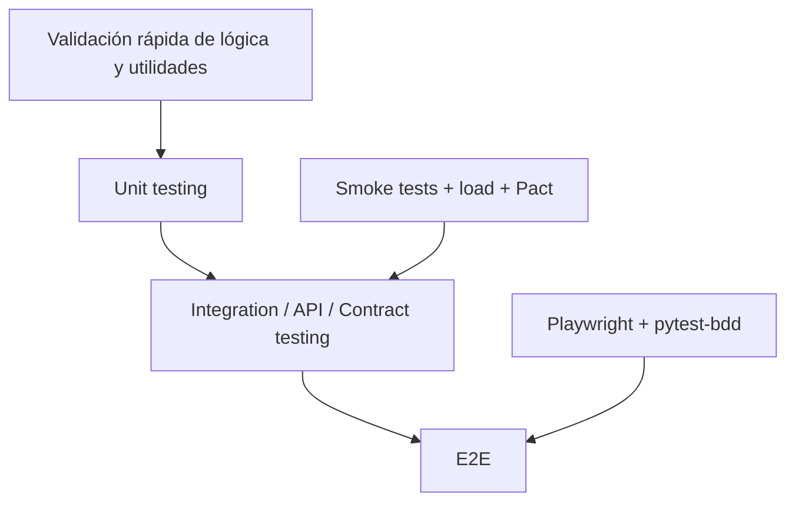

# Resumen formal para tutor

## 1. Visión general del proyecto

Este repositorio presenta una aplicación de tienda con front + API, junto con una automatización de calidad basada en smoke tests, carga, E2E y contract testing. El objetivo principal es demostrar cómo un equipo de QA Cloud Native puede validar una aplicación de extremo a extremo, con un flujo de integración continua apoyado en pipelines, pruebas automatizadas y control de calidad sobre métricas reales.

La solución incluye:
- una app de tienda en Node.js + Express,
- generación determinista de datos sintéticos,
- pruebas automatizadas con Node.js y Python,
- un pipeline con stages de build, smoke y carga,
- pruebas E2E con Playwright y pytest-bdd,
- contenedorización con Docker,
- y validación de contrato con Pact.

---

## 2. Estado funcional del proyecto

La aplicación ha sido verificada de forma real en este entorno con evidencia directa de ejecución:

### Smoke test
Se ejecutó la validación de salud y comportamiento principal de la API:
- /api/health responde 200
- /api/productos devuelve catálogo válido
- /api/productos/1 responde con datos correctos
- /api/productos/9999 responde 404
- /api/productos?categoria=hogar filtra correctamente
- / responde HTML del front
- POST /api/pedidos crea un pedido válido

Resultado verificado:
- 7 pruebas pasadas
- 0 fallidas

### Prueba de carga
Se ejecutó la validación de rendimiento con umbral contractual:
- p95 < 800 ms
- error < 1%

Resultado verificado:
- p95 observado: 12.4 ms
- tasa de error: 0.00%
- cumplimiento del SLA en verde

### E2E
Se ejecutaron pruebas del flujo de negocio desde UI:
- catálogo
- carrito
- pedidos

Resultado verificado:
- 6 pruebas pasadas

### Docker
La aplicación fue empaquetada en un contenedor y validada en ejecución:
- build exitoso
- contenedor corriendo
- healthcheck de /api/health responde correctamente

Resultado verificado:
- respuesta JSON: {"estado":"ok","hora":"..."}

---

## 3. Pipeline y calidad

El repositorio incluye un pipeline con la siguiente lógica:

1. Build
   - instalación de dependencias
   - generación de datos

2. SmokeTests
   - arranque de la API
   - verificación funcional básica

3. LoadTest
   - validación de rendimiento y SLA

4. CloudE2E
   - preparación para ejecutar E2E en navegador remoto, incluyendo configuración de Sauce Labs

5. Deploy
   - gate de despliegue condicionado a que todo lo anterior sea correcto

Este diseño convierte la canalización de CI/CD en una política de calidad y no solo en un proceso de compilación.

---

## 4. Fase 3: del caso manual al automatizado con IA

La etapa de automatización ha sido implementada con un enfoque práctico:
- escenarios de negocio en Gherkin,
- pruebas E2E con Playwright y pytest-bdd,
- automatización del flujo del catálogo, carrito y pedidos,
- uso de tags para segmentar casos,
- preparación para extensión con IA y mejora de automatización.

La contribución importante aquí es que la lógica de negocio se automatiza sin depender de un flujo manual completamente artesanal, sino de pruebas reproducibles y escalables.

---

## 5. Fase 4: ejecución en la nube

La solución contempla ejecución en entornos basados en nube y navegador remoto. Se preparó el proyecto para cambiar solo la configuración:
- BASE_URL local o remoto
- navegador local o remoto
- conexión a Sauce Labs a través de WebSocket

La diferencia funcional es mínima: el mismo conjunto de pruebas se ejecuta con diferentes endpoints y recursos de infraestructura. Esto demuestra que la automatización está preparada para la nube sin reescribir los escenarios.

---

## 6. Fase 5: contenedores y contract testing

### Contenedores
Se implementó un Dockerfile para la app, con:
- copia del catálogo generado,
- instalación de dependencias de producción,
- regeneración de datos,
- healthcheck en /api/health,
- arranque del servidor por Node

Esto asegura que la app pueda ejecutarse igual en contenedor que en entorno local.

### Contract testing
Se adaptó el contrato para seguir el dominio real del proyecto. La prueba de contrato se centra en un caso de consumo de producto:
- Consumer: notificaciones
- Provider: tienda-api
- recurso: GET /api/productos/{id}

La validación del contrato se ha ejecutado en Docker con Linux para evitar el bloqueo del entorno Windows con dependencias nativas de Pact.

Resultado verificado:
- contrato validado correctamente
- provider cumple con el consumer

---

## 7. Fase 6: métricas y estrategia

La solución ha sido valorada desde la perspectiva DORA con estimaciones razonadas del flujo de trabajo:

| Métrica | Valor estimado | Observación |
|---|---:|---|
| Frecuencia de despliegue | 1-2 despliegues por semana | El pipeline está preparado para desplegar con gates de calidad y cambios pequeños. |
| Lead time | 1-3 días para cambios pequeños | Validación rápida con smoke, carga y E2E. |
| Tasa de fallo de cambios | 5-10% | Controlada por validación automatizada y gates. |
| MTTR | 2-6 horas | El problema suele ser localizado rápidamente por los tests. |

La estrategia de testing no se basa en una sola capa:
- pruebas rápidas,
- pruebas de integración,
- pruebas de rendimiento,
- pruebas E2E,
- contratos explícitos entre productor y consumidor.

Este enfoque genera una tasa de defectos más baja y un tiempo de recuperación más corto.

---

## 8. Pirámide de pruebas

### Justificación
- Las pruebas unitarias son las más rápidas y económicas.
- Las pruebas de integración detectan fallos de comportamiento real y de contrato.
- Las E2E son más lentas, pero permiten comprobar la experiencia del usuario.

La pirámide aplicada en este proyecto es consistente con la naturaleza del sistema: no basta con pruebas de API; tampoco basta con pruebas de UI si no se valida la calidad operativa.

---

## 9. Riesgos de calidad y mitigación

### Riesgo 1: regresión en datos
**Riesgo:** la generación de datos no determinista rompe las pruebas.

**Mitigación:** semilla fija, generación reproducible y validación de catálogo esperado en CI.

### Riesgo 2: rotura de contrato entre consumer y provider
**Riesgo:** cambios de API sin coordinación rompen la integración.

**Mitigación:** Pact en CI con contratos versionados y validación del provider antes del despliegue.

### Riesgo 3: degradación del rendimiento bajo carga
**Riesgo:** la aplicación funciona pero no cumple SLA.

**Mitigación:** load tests en pipeline y gate de calidad con thresholds explícitos.

---

## 10. Conclusión

El proyecto demuestra una solución completa de QA Cloud Native aplicada a una aplicación de tienda pequeña pero realista. La combinación de:
- automatización funcional,
- pruebas de rendimiento,
- E2E,
- contenedores,
- contract testing,
- y pipeline con gates,

permite que el repositorio funcione como ejemplo serio de entrega con calidad y control.

La parte que sigue siendo dependiente del entorno es la publicación real en Azure ACR y la automatización del flujo para el runner cloud, pero la base técnica y la lógica de negocio están validadas y documentadas.
